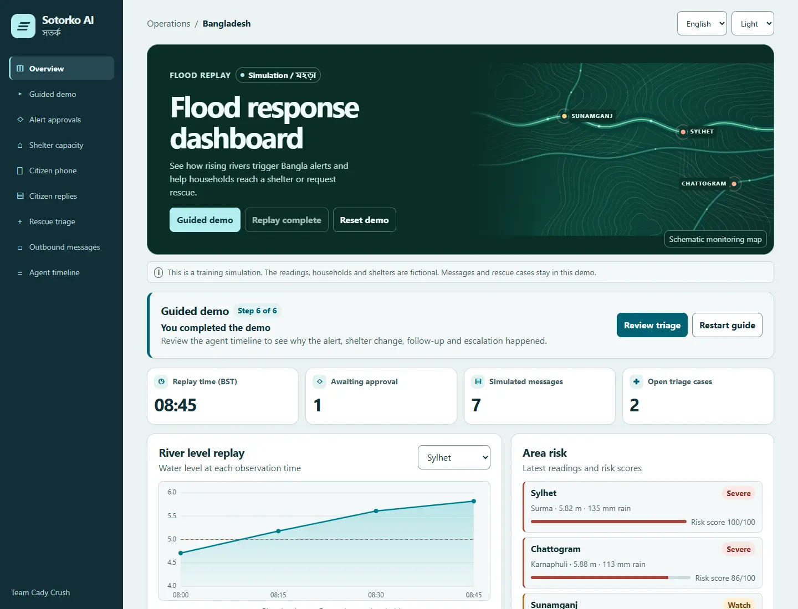
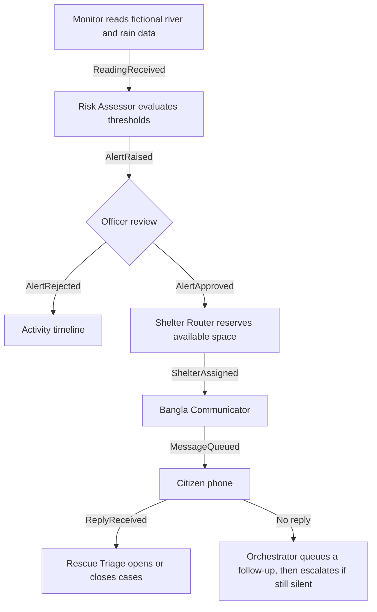

# Sotorko AI · সতর্ক

**A bilingual flood-response dashboard with Bangla alerts, shelter routing, and rescue triage.**

Sotorko AI is Team Cady Crush’s hackathon prototype for Bangladesh. It turns simulated river readings into officer-approved Bangla alerts, assigns households to shelters with space, and follows up when people ask for help or haven’t replied.

**[Open the live demo](https://sotorko-ai.onrender.com/)**

[Quick start](#quick-start) · [Try the demo](#try-the-demo) · [How it works](#how-it-works) · [Team and materials](#team-and-materials)



*The officer console during a fictional flood replay in Sylhet, Chattogram, and Sunamganj.*

## What you can try

- **Take the guided tour.** Select **Guided demo**, then use **Next step** to find each action. Switch between English and বাংলা, and light or dark appearance, at any point.
- **Monitor changing risk.** Replay fictional readings from Sylhet, Chattogram, and Sunamganj. The river chart and animated monitoring graphic update as the scenario advances.
- **Approve severe alerts.** Review the threshold crossing and approve or reject delivery. The Bangla outbox previews SMS, WhatsApp, and voice calls.
- **Reroute when a shelter fills.** The shelter router reserves space for each household and reassigns it when the original shelter fills.
- **See both sides of the conversation.** Inspect the Bangla alert or call script in the citizen phone. A keypad reply can mark a household safe or request help. A message like **আমরা আটকে আছি, ৫ জন** (“We’re stranded, five people”) creates a rescue case for officer review.
- **Follow up, escalate and audit.** The orchestrator queues a simulated Bangla voice reminder for households still awaiting a reply, escalates anyone still silent to a ward volunteer, and records each decision in the activity log.
- **Re-raise rejected alerts.** If an officer rejects an alert and the river keeps rising by 0.25 m or more, the alert comes back for review.

## Quick start

Install **Node.js 20 or later**, then run this from the cloned or downloaded project folder.

```sh
npm start
```

Open **[http://127.0.0.1:4173](http://127.0.0.1:4173)**. The demo runs without package installation, API keys, or an external service.

## Try the demo

Open **Guided demo**, then select **Next step** to highlight and focus the control for each action. Start at 08:00 with **Restart guide** if you’ve already explored the replay.

| Step | What to do | What you should see |
| --- | --- | --- |
| 1 | Select **Advance 15 min**. | At **08:15**, Sylhet’s simulated Surma reading crosses the demo threshold. A severe alert waits for approval. |
| 2 | Approve the **Sylhet** alert. | Three households receive simulated Bangla messages across SMS, WhatsApp, and voice. |
| 3 | Select **Simulate full** on **Sylhet School Shelter**. | The shelter router reassigns households to **Sylhet Community Hall** and adds new delivery previews. |
| 4 | In **Citizen phone**, send **Safe · ১** for Rahima and the sample rescue reply for Jamal. | Rahima is marked safe. Jamal’s message opens a rescue case for five people. |
| 5 | Advance to **08:30**. | Salma receives a simulated voice follow-up. Chattogram’s severe alert enters its own approval queue. |
| 6 | Advance to **08:45**. | Salma is still silent, so a **No response** case asks the ward volunteer to check in person. If a household later replies safe, its open case closes automatically. |

The replay, language, and theme are saved in your browser. Select **Pause motion** for a still graphic, or use your device’s reduced-motion setting.

## How it works



Six JavaScript agent modules exchange events through a synchronous bus. Pure reducers update a single store, so a given replay and set of decisions always produce the same result. The bilingual activity timeline explains why each action happened. [Architecture and event details](docs/ARCHITECTURE.md)

| File | Role |
| --- | --- |
| [simulation.js](simulation.js) | Simulation API used by the dashboard and replay tests |
| [src/agents](src/agents) | Six workflow agents |
| [src/core](src/core) | Event bus, reducers, and end-to-end simulation tests |
| [src/adapters](src/adapters) | Fictional data, simulated delivery, and optional server-side review |
| [src/ui](src/ui) | Language dictionary, guide, and citizen phone logic |
| [dashboard.js](dashboard.js) | Dashboard controls, chart rendering, and browser storage |
| [basin.js](basin.js) | Animated monitoring illustration and risk markers |
| [server.mjs](server.mjs) | Local HTTP server |

Run `npm test` for the original workflow regressions, agent and reducer tests, bilingual string coverage, and HTTP checks.

### Deploy on Render

Use a **Static Site** connected to the GitHub `main` branch. Set **Build Command** to `npm run build`, **Publish Directory** to `dist`, and **Auto-Deploy** to **On Commit**. The build publishes the HTML, styles, and browser modules.

For an existing deployment using the old file-copy command, update the Render setting before the first redesign deploy. If you need one command that builds either revision during that transition, use the following, then switch to `npm run build` once the redesigned commit is live.

```sh
if node -e "process.exit(require('./package.json').scripts.build ? 0 : 1)"; then npm run build; else mkdir -p dist && cp index.html style.css dashboard.js basin.js simulation.js favicon.png dist/; fi
```

### Optional local AI review

Run the local Node server with `OPENAI_API_KEY` set in its environment to enable **Ask AI to review this simulated reply** on open citizen cases. Clicking it prompts you before sending the fictional reply for a suggested category and reason. The rule-based workflow still owns the case and falls back to its classification when the provider is unavailable. The Render Static Site uses the local rules entirely in the browser. [Structured Outputs](https://developers.openai.com/api/docs/guides/structured-outputs)

### Prototype scope

All readings, thresholds, shelter locations, capacities, households, and deliveries are simulated. The monitoring illustration is schematic. Voice previews use a local Bangla browser voice when available, with the call script shown in the outbox. Rescue cases stay in the dashboard.

The proposal describes a future field pilot with live data, trained flood-risk and Bangla language models, verified shelter routes, and delivery providers. River names follow the [Flood Forecasting & Warning Centre bulletin](https://ffwc.gov.bd/app/flood-bulletin-morning) and [Chattogram District’s river listing](https://chittagong.gov.bd/pages/static-pages/6991007335ce18e1c073288c).

## Team and materials

**Team Cady Crush** · Daffodil International University

24H AI Builders Hackathon · MU CSE FEST 2026 · Agentic AI & Autonomous Systems track

| Team member | Role |
| --- | --- |
| Nahid Ibn Zaman | Team lead, development, and backend |
| Md. Rasel Hasan Sabuj | Agent orchestration and messaging |
| Md Tusher Hossen | Flood-risk modeling and Bangla NLP |
| Md. Ha-Mim Ferdowsh | Data pipeline and river sensors |

[Idea proposal (PDF)](Sotorko-AI_Proposal_CadyCrush.pdf) · [Proposal source](docs/proposal.html) · [Pitch script](docs/video-script.md)
