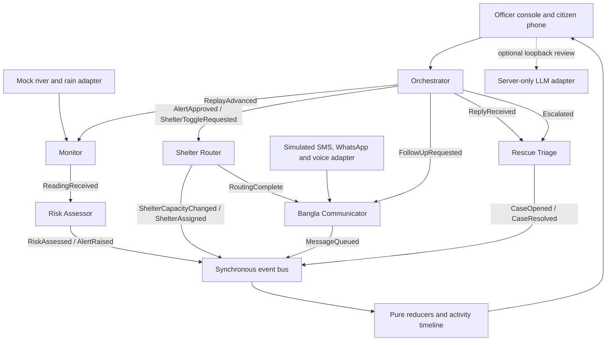

# Sotorko AI architecture

The dashboard and citizen phone are two views of the same deterministic flood exercise. Both call the commands in [simulation.js](../simulation.js). The orchestrator validates a command, publishes it, and waits for the event queue to drain before the dashboard renders or saves the new state.

The labels show the event paths. Agent subscriptions and store updates all run through the bus.

## Plan, act, verify

1. **Plan.** The Monitor reads a fictional snapshot using the [data adapter](../src/adapters/dataSource.js). The Risk Assessor scores the areas and emits a recommendation. An officer must approve a severe alert before any delivery is queued.
2. **Act.** The Shelter Router reserves capacity one household at a time. The Bangla Communicator uses the [delivery adapter](../src/adapters/delivery.js) to create preview messages. Shelter changes can trigger another routing pass.
3. **Verify.** Rescue Triage classifies each reply and opens or closes a case. After a later tick, the Orchestrator queues one voice follow-up for a silent household. If it stays silent, the Orchestrator escalates the case once.

## State and localization

The [event bus](../src/core/events.js) applies each event to the [store](../src/core/store.js) before notifying listeners, and processes events published by listeners in FIFO order. The compatibility API copies the resulting store snapshot back to the caller’s state object once per completed command. Built-in fixtures, rules, and replay ticks keep tests independent of external services.

New activity entries store a message key and typed parameters. The dashboard translates those at render time, so already-recorded activity can appear in either language. Older saved entries may still display their original English text. Bangla delivery scripts and citizen replies retain their own language.

## Runtime boundaries

The [browser asset manifest](../scripts/assets.mjs) is shared by the local server and the static build. A Render Static Site runs the replay in the browser. The Node server’s optional [LLM adapter](../src/adapters/llm.js) runs over a same-origin loopback endpoint. It offers an advisory review of fictional text on demand, with a timeout and a rule-based fallback. Provider suggestions never send messages, approve alerts, or change case state.
